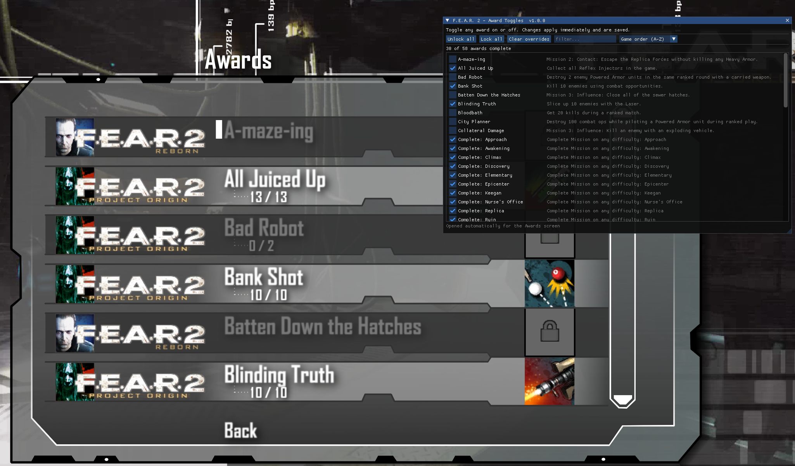

# Fear2AwardUnlocker

An in-game mod for **F.E.A.R. 2: Project Origin** that adds a **panel of toggles for every award**,
letting you flip each one **on or off** (plus *Unlock all* / *Lock all*).

**Opens itself on the Awards screen** (see below).



**Steam-safe:** F.E.A.R. 2 has **no Steam achievements at all**, so there is nothing for this mod to
touch on Steam even in principle. It drives only the game's own local award state — the same state
the Awards screen reads.

## How it works (discovered)

F.E.A.R. 2 calls its awards *achievements* internally; the string "Award" appears nowhere in the
binaries, only in the localized UI text. The 58 awards are records in the `Interface/Achievements`
category of `Database\Loki.gamedb`, and **the game stores one byte per award** in your profile —
the same byte it writes itself when you earn one. That byte is the whole of an award's state, and
it is what this mod toggles.

The profile is `Documents\WBGames\FEAR2\<steamid>\Profiles\Profile000.gps`, a flat key/value
file with no checksum:

```
u32 version(17)  u32 version(17)  u32 recordCount
recordCount x { u32 crc32(name), u32 valueLen, <value> }
```

Records are keyed by the CRC-32 of their name, and an award's name is built as
`"Achievements" + <the award's Storage record>` — for example `AchievementsPCACH_LaserKills`. Miss
that `"Achievements"` prefix and the awards look absent from the save entirely, which is exactly the
wrong turn this project took at first.

Separately, most awards name a **counter** in `Interface/GameProfileData` plus a **threshold**; the
game sets the award's byte once `counter >= threshold`. That is how an award gets *earned*, not
where it is *kept* — which is why the nine Reborn (DLC) awards, which have no counter at all on PC,
are still stored exactly like the other 49.

The mod ships as a proxy `LTMemory.dll` (the game imports exactly one symbol from it, which we
forward), and hooks the achievement manager's `IsAchievementComplete` — slot 8 of the vtable at
`gameclient.dll+0x1C9738` — so the panel reflects a toggle the instant you click it.

The toggle itself writes that award byte into **both** the live profile in memory and the `.gps`
file on disk. It is a change to the game's own saved state, not a mod-side overlay: it survives a
restart, and it survives deleting the mod. The game only flushes its in-memory copy when it feels
like it, so writing both means the two always agree no matter which one wins.

## Caveats worth knowing

- **Every award persists, the nine Reborn (DLC) ones included.** Nothing is kept mod-side and there
  is nothing to re-apply at launch — the change goes into the save and stays there.
- **Toggling an award off does not undo the progress behind it.** The mod clears the award itself,
  not the counter it was earned from, so if you switch off an award whose condition you have really
  met, the game may grant it again the next time that counter moves. The mod writes
  `Profile000.gps.bak` once, before its first ever change.
- **Steam's "Verify integrity of game files" restores the stock DLL** and removes the mod. Re-run
  `make install` (or re-copy the files) if that happens.
- The game's own Awards screen updates too. It renders a copy of the data C++ pushed to Flash when
  the menu was built, so the mod asks the game to send that data again after a toggle — the same
  call the game makes itself when the menu is constructed. The rows repaint the next time the
  screen is drawn, so leave the Awards screen and come back if you toggled while looking at it.

## Install

Copy into the F.E.A.R. 2 folder (the one with `FEAR2.exe`):

1. Rename the stock `ltmemory.dll` to `LTMemory_orig.dll`.
2. Drop this mod's `LTMemory.dll` in its place.

That is the whole install, on **Windows and on Linux/Proton alike** — `ltmemory` is not a Wine
builtin, so no `WINEDLLOVERRIDES` launch option is needed.

To uninstall, delete `LTMemory.dll` and rename `LTMemory_orig.dll` back.

## Build

Cross-compiled on Linux with mingw-w64; no MSVC and no Windows needed.

```sh
cp config.mk.example config.mk     # set GAME_DIR to your install
make                               # -> build/LTMemory.dll
make install                       # deploy (does the rename above for you, once, safely)
make uninstall                     # put the stock DLL back
```

### Versioning and releases

The version lives in the `VERSION` file and nowhere else; the build compiles it into the DLL, so
the log banner and the panel's title bar always report the running build.

```sh
make version           # print the current version
make rev 1.1.0         # set a new version (X.Y.Z only)
make package           # -> dist/Fear2AwardUnlocker_1.1.0.zip
```

`make package` assembles `dist/Fear2AwardUnlocker/` (the DLL, README, LICENSE and an INSTALL.txt)
and zips it as `<project>_<version>.zip`. Extracting it gives you the files to drop in as above.
Changing the version rebuilds the mod's own objects automatically, so a package can never carry a
stale version string.

`make install` refuses to overwrite `LTMemory_orig.dll` if the live DLL is already the mod, so it
can never enshrine the mod as the "stock" copy.

The award table is generated from the game's own data rather than hardcoded:

```sh
python3 tools/gen_awards.py --game-dir "$GAME_DIR"   # -> src/awards_table.h
python3 tools/gen_awards.py --game-dir "$GAME_DIR" --print   # show the table
```

## Usage

The panel opens by itself when you reach the Awards screen — nothing to press, and nothing to set
up first. To bring it up anywhere else in the game, press **F8**. Click a checkbox to toggle that
award; changes apply immediately and are written into your F.E.A.R. 2 profile.
*Unlock all* and *Lock all* act on every award at once, and the filter box narrows the list.
*Clear overrides* only resets the panel's own display back to what the game reported at launch — it
does not undo anything you have already saved.

Award names and descriptions are the game's own, in whatever language you play in — the mod asks
the engine to localize them rather than shipping its own copies.

### Opening automatically on the Awards screen

**Nothing to set up.** The panel opens by itself when you enter the Awards screen and closes again
when you leave it. Set `AutoShow = 0` in the ini if you would rather it never did.

Detecting the screen takes an inference, because F.E.A.R. 2 gives no C++ notification when it opens
— the award rows are pushed into Flash once while the menu is built, and the screen just renders
that. That silence is itself the signal: of every entry on the main menu, the Awards screen is the
only one that runs no game code at all. So the mod watches the ActionScript → C++ menu bridge, and
when a selection is followed by 350 ms of complete quiet, that is the Awards screen. No screen id,
no setup, and the same behaviour on every install.

While you are on that screen the panel stays up — F8 will not dismiss it there, since it is
re-opened on the next frame. Everywhere else F8 toggles it freely.

### Row order

The game hands its Awards screen to Scaleform once, keyed on `AchievementIndex`, and the Flash
table sorts the rows itself — so the on-screen order is not recoverable from the game files. The
panel therefore offers a sort selector (game order A-Z, award index, points, completed-first,
database order); pick whichever matches your Awards screen and it is remembered. The default, game
order A-Z, is the one that matches the stock screen.

## Config (`Fear2AwardUnlocker.ini`, beside `FEAR2.exe`)

Settings only — the panel's own preferences. Award state is not kept here; it goes into your
F.E.A.R. 2 profile.

```ini
ToggleKey   = 0x77  ; virtual-key code that opens the panel (0x77 = F8)
ShowOnStart = 0     ; open the panel as soon as the game starts
AutoShow    = 1     ; open the panel automatically on the Awards screen
SortMode    = 0     ; 0 game order (A-Z), 1 award index, 2 points, 3 completed first,
                    ; 4 database order
```

Older versions of the mod kept award state here, as `ACH_Name = on | off` lines. Those are ignored
now and dropped the next time the file is written; the save is the only place award state lives.

## Credits

- [Dear ImGui](https://github.com/ocornut/imgui) (MIT) is vendored in `contrib/imgui`.
- [praydog/FEAR2VR](https://github.com/praydog/FEAR2VR)'s reversing notes documented the engine's
  console-variable tables and confirmed that F.E.A.R. 2's menu input only travels through
  `GFxMovieView::HandleEvent` — which is why this mod draws its own panel rather than trying to add
  controls to the game's Scaleform Awards screen.

## License

GPL-3.0. See `LICENSE`.
